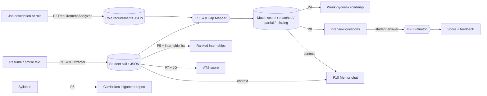
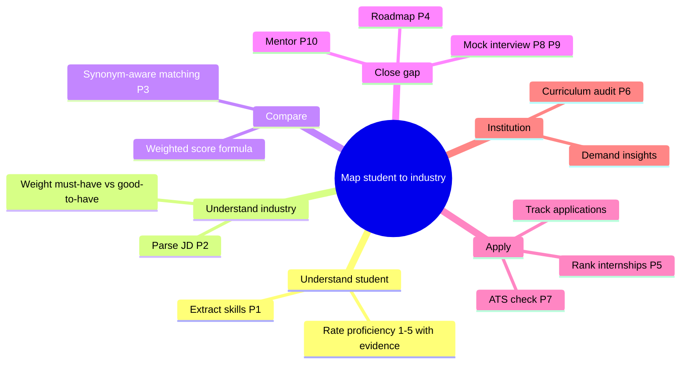
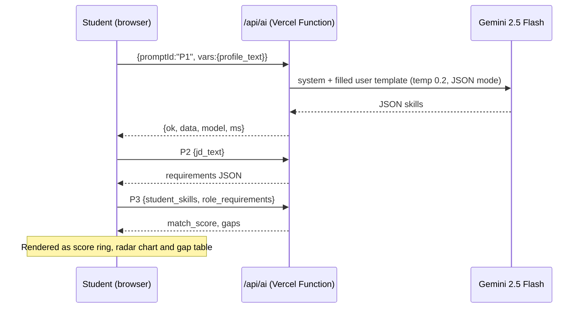
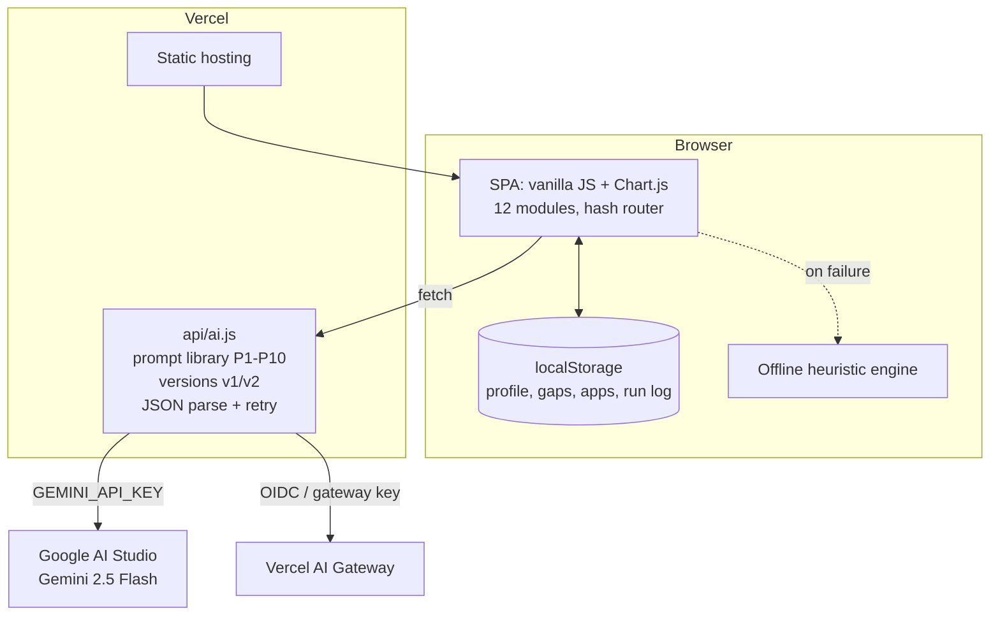

# Bridgr: Diagrams (Milestone 2)

These Mermaid diagrams render on GitHub. They describe the system exactly as built in `code/`.

## 1. Prompt workflow

## 2. Task decomposition

## 3. Input–output flow (core path)

## 4. System architecture

